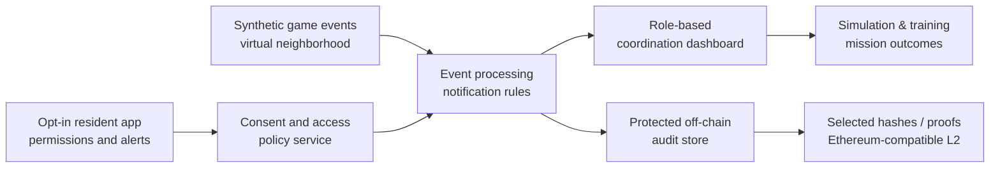

# Peace Game: AIRFORCE-1

### Project Sentinel — a consent-based community security coordination concept

**A Technibears concept proposal · October 2026**

> **Mission:** Build a playable, satellite-map-inspired neighborhood simulation that demonstrates how voluntary security alerts, authorized community coordination, and cryptographic accountability could work together — without turning ordinary residents into surveillance targets.

**Status:** Concept / proposed proof of concept. Not an approved military program, operational security product, or government deployment.

## At a glance

A resident opts in to a limited property-watch service. A permitted departure event (such as leaving home) updates the household's chosen status. An authorized coordinator sees only the information needed to support that service. In a simulation, this appears as a mission or event on a 3D neighborhood map.

The first build is a **game-like demonstration using entirely synthetic data**, not live vehicle tracking.

| Layer | Purpose |
|---|---|
| **Peace Game** | Interactive neighborhood digital twin, training missions, role-based simulations |
| **Resident experience** | Voluntary enrollment, consent settings, property-watch status, opt-out |
| **Coordination** | Approved alerts, assignment acknowledgement, incident workflows |
| **Ethereum-compatible audit** | Optional proof of governance decisions, consent revisions, and audit integrity |
| **Privacy & security** | Off-chain personal data, access controls, data retention and independent review |

## How a sample mission works

1. **Opt in:** A fictitious resident enables the optional "Away / Property Watch" mode.
2. **Simulated event:** Their simulated vehicle departs the property.
3. **Share minimally:** The system emits a designated property-watch event, not a live location trail.
4. **Coordinate:** A verified coordinator acknowledges the watch request in the map interface.
5. **Audit:** The system records the authorized action and an integrity proof.
6. **Revoke:** The resident can end their participation at any time.

## The game versus the proposed real-world service

**Gameplay and prototype:** A geospatial neighborhood map, animated vehicle departures, volunteer/responder roles, simulated incidents, readiness exercises, dashboards, and clear consent indicators. All persons, homes, vehicles, and events are fictional.

**Possible real-world pilot:** Only after institutional approval, privacy review, security evaluation, and an informed opt-in process. Any integrated resident alerts would use approved consumer devices or vehicle integrations and would be intentionally narrower than continuous tracking.

**No claim of authority:** Neither this project nor a blockchain record creates military, policing, investigative, detention, or surveillance powers.

## Reference architecture

**Why not put movement data on Ethereum?** Public ledgers are permanent and observable. Home addresses, vehicle identities, exact locations, and movement timestamps do not belong on-chain. Blockchain is an optional accountability component, not a location sensor or time-critical messaging system.

## Proposed milestones

**M1 — Interactive simulation:** Digital neighborhood; simulated households, vehicle departures, and map events; resident and coordinator views.

**M2 — Consent and coordination:** Opt-in/opt-out controls; permission matrix; alerts and acknowledgements; simulated workflows; audit logs.

**M3 — Ethereum feasibility:** Evaluate audit proofs, cost, usability, recoverability, and a non-blockchain alternative; independent privacy/security review.

**M4 — Pilot readiness decision:** Demo evaluation, measurable success criteria, legal/organizational sign-off checklist, and a go/no-go recommendation. No live field deployment is assumed.

## Success criteria

Evaluate reliability of simulated alerts, user comprehension of consent, inappropriate access prevention, coordinator acknowledgement performance, training usability, and security risks. Do **not** use the volume of collected movement data as a success metric.

## Proposal

Read the complete concept proposal: **[Project Sentinel — Proposal](docs/PROJECT_SENTINEL_PROPOSAL.md)**.

## Copyleft license

Copyright © 2026 Technibears LLC.

Unless otherwise noted, this repository, including its proposals and future software, is released under the **GNU Affero General Public License, version 3 or later (AGPL-3.0-or-later)**. See [LICENSE](LICENSE) for the complete terms.

You may use, study, modify, and redistribute the licensed material under those terms. Redistributed adaptations must preserve the applicable copyleft requirements; modified network software must also offer its corresponding source to users interacting with it over a network. Copyleft does **not** prohibit commercial use or guarantee payment to the original authors.

Licensing does not confer military, police, security, or other governmental authority, and third-party trademarks and assets are not automatically relicensed.

## Intended audience and attribution

Prepared by **Technibears** for a concept discussion with **Zachariah**, a pilot serving in the military. This is an independently proposed idea; no defense organization or agency has sponsored, reviewed, or endorsed it.

## Boundaries

- Only voluntary, revocable participation in any future service.
- No covert tracking, facial recognition, continuous individual monitoring, or neighborhood-wide surveillance.
- No sensitive resident or vehicle data stored on a public blockchain.
- No civilian enforcement or military operations without applicable legal authority and formal command approval.
- No production integrations or access to live telemetry in the initial proof of concept.

*Peace Game: AIRFORCE-1 is currently a conceptual software and simulation initiative, not a functioning application.*
