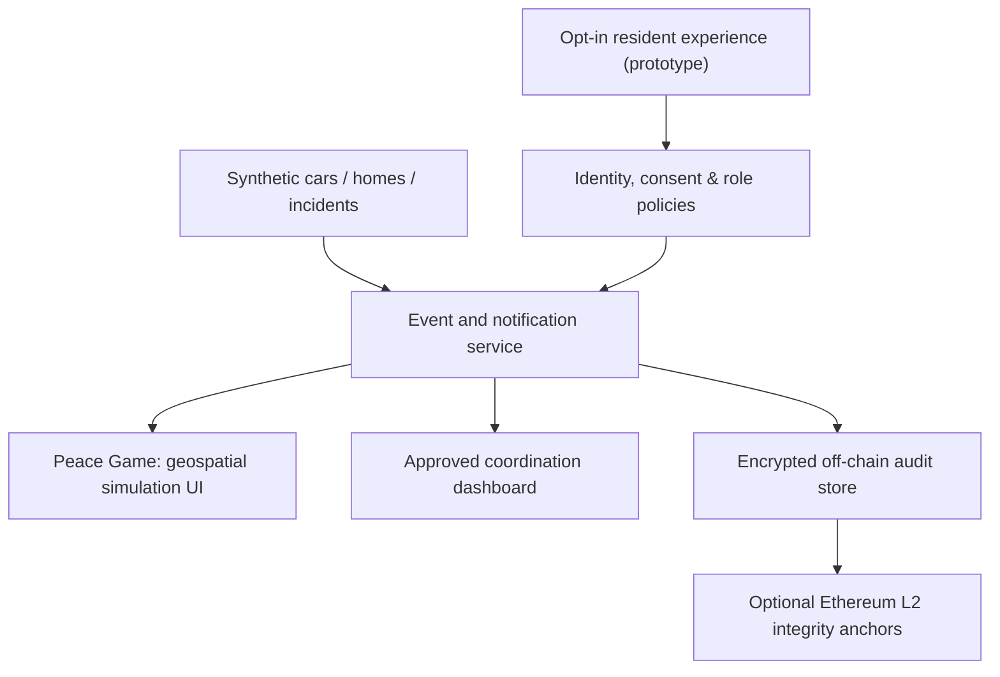

# Project Sentinel
## Peace Game: AIRFORCE-1 — Concept and Feasibility Proposal

**Prepared by:** Technibears  
**Prepared for:** Zachariah, military pilot (informal concept discussion)  
**Date:** October 12, 2026  
**Document status:** Exploratory proposal, not a military procurement submission or approved operation

---

## 1. Executive summary

Project Sentinel is a game-inspired, consent-based community security coordination concept. It combines a geospatial neighborhood simulation, voluntary property-watch alerts, carefully controlled coordinator roles, and optional Ethereum-compatible audit verification.

The initial deliverable is a **playable virtual neighborhood** with synthetic homes, vehicles, participants, events, and training missions. Its purpose is to communicate the concept clearly and evaluate whether it deserves a real-world feasibility study.

The long-term ambition is a trustworthy opt-in safety service that helps consenting residents communicate security needs to approved coordinators without exposing continuous location traces or creating informal law enforcement powers.

## 2. Problem and opportunity

Neighborhood watch and emergency readiness often rely on fragmented communication, informal volunteers, and limited evidence of who was authorized to act. A training-oriented digital twin could help stakeholders practice coordination, evaluate user experience, and establish governance boundaries before investing in operational systems.

Satellite-style imagery is a useful **map and user-interface metaphor**, not a promise that orbital sensors can reliably detect when a particular car leaves a garage. Real departure signals, if ever approved, would come from an opt-in user device, supported vehicle integration, or user-controlled status toggle.

## 3. Core product experience

### Resident

A household voluntarily enrolls and chooses which security events may be shared, with whom, and for how long. Available concepts include "Away / Property Watch," emergency assistance, temporary coordination, and one-click participation revocation.

### Coordinator

Authorized personnel see relevant status changes and assigned incidents based on their role. They do not receive open-ended access to individual movement histories. Actions, acknowledgments, and administrative approvals are auditable.

### Training player

A player enters a stylized neighborhood map, receives synthetic assignments, and practices communication, escalation, readiness, and incident response. Mission scoring rewards appropriate procedure and privacy compliance, not surveillance volume.

## 4. Example simulation

1. A fictional household enables an opt-in property-watch setting.
2. Its simulated vehicle departs a virtual driveway.
3. An event processor checks the fictional consent configuration.
4. An approved coordinator receives an "Away / Watch Enabled" event with minimal household details.
5. The coordinator acknowledges a property-watch request.
6. The game records a training outcome and an internal audit event.
7. A selected cryptographic digest may be anchored on an Ethereum-compatible network.
8. The fictional resident revokes access; subsequent events stop being shared.

No real telemetry, license plates, precise live locations, biometric data, or civilian identities are necessary for this demonstration.

## 5. Technology architecture

**Geospatial visualization:** Map tiles or licensed satellite imagery with a stylized virtual world overlay. For the MVP, an entirely fictional map is preferable.

**Application and event layer:** Secure API, notification rules, protected event storage, simulated vehicle actions, and observability.

**Authorization:** Explicit consent, role-based access controls, event-level checks, expiry, revocation, and a tamper-evident audit log.

**Ethereum integration:** Optional anchoring of hashes for selected consent-policy revisions, governance approvals, or audit batches. Never put home addresses, vehicle identities, location histories, or person-level alerts on-chain.

**Operational resilience:** A database and conventional messaging infrastructure handle real-time app functionality. The demo must remain usable when a blockchain network is unavailable.

## 6. Proposed gamification

The interface could resemble a strategy game: a top-down/isometric neighborhood, simulated moving vehicles, opt-in property markers, clearly bounded team assignments, incident simulations, and after-action reviews.

Training missions could include preparing for severe weather, checking communication protocols during a power outage, dispatching appropriate emergency information, or resolving a simulated false alarm. Rewards recognize procedural correctness, restraint, and team coordination.

## 7. Governance model

A community security *coordination function* is a possible organizational concept, not an automatically established department.

For any real-world application, responsibilities and oversight would need to be defined by the relevant civilian institutions, property authorities, emergency services, and, where applicable, military chains of command. This proposal does not authorize neighborhood patrols, detention, pursuits, intelligence collection, or coercive activity.

A documented policy should specify eligibility, identity verification, consent, incident escalation, retention, complaints, independent review, and termination of access.

## 8. Staged delivery

| Milestone | Scope | Demonstration outcome |
|---|---|---|
| 1. Game prototype | Fictional map, vehicle movement, households, role selector | Playable simulated departure-and-alert loop |
| 2. Consent & coordination | Permission screens, roles, simulated notifications, acknowledgment workflow | End-to-end auditable user journey |
| 3. Accountability research | Off-chain audit proofs, optional Ethereum L2 anchoring, chain/no-chain comparison | Measured feasibility and risk report |
| 4. Institutional feasibility | Privacy/security evaluation, acceptance metrics, legal review checklist | Go/no-go recommendation for further study |

Schedules, staffing, budgets, and production requirements would be determined following a technical discovery session and a clearly identified sponsor. No fixed delivery or commercial commitment is implied.

## 9. Success measures

- Reliable delivery and acknowledgment of *simulated* events.
- Clear resident understanding of the permissions being granted.
- No unauthorized access to restricted household information.
- Effective consent expiry and revocation.
- Training completion, user comprehension, and acceptable false-alert handling.
- Blockchain overhead evaluated against a simpler signed audit log.
- Independent review of operational, legal, privacy, and security risks.

## 10. Commercial and deployment questions

Before pricing or field deployment, stakeholders should establish:

1. Is the desired product primarily a **video game / training simulator** or an operational community app?
2. Who has legal authority to administer it, and in what jurisdiction?
3. Is the deployment civilian, municipal, housing-community, or formally military-sponsored?
4. What resident signals can be legally and reliably collected with active consent?
5. What tangible benefit does Ethereum provide over standard cryptographically signed audit records?
6. Who funds product development, cybersecurity review, maintenance, and operator training?

The suggested first commercial engagement is a separately scoped and priced **simulation MVP**, not an open-ended real-world security deployment.

## 11. Conclusion

Peace Game: AIRFORCE-1 should initially make the idea understandable and testable: a virtual neighborhood in which consenting fictional residents signal property-watch status, authorized fictional coordinators handle events, and all meaningful actions are auditable.

If stakeholders find the concept compelling, a subsequent feasibility exercise can consider legitimate institutional ownership, careful civilian safeguards, and strictly voluntary integrations.

**Design principle:** Help participating communities coordinate safety without constructing a system of indiscriminate surveillance.

---

*© 2026 Technibears. Concept discussion document. No endorsement by, affiliation with, or authorization from any military branch or government agency is asserted.*
